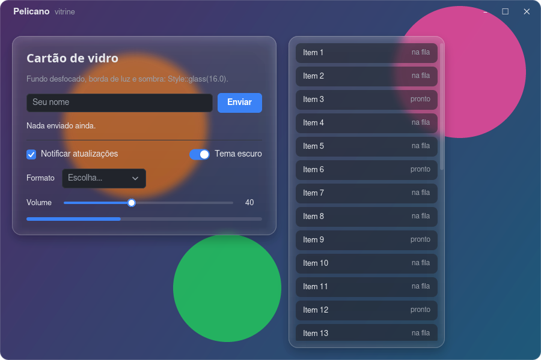
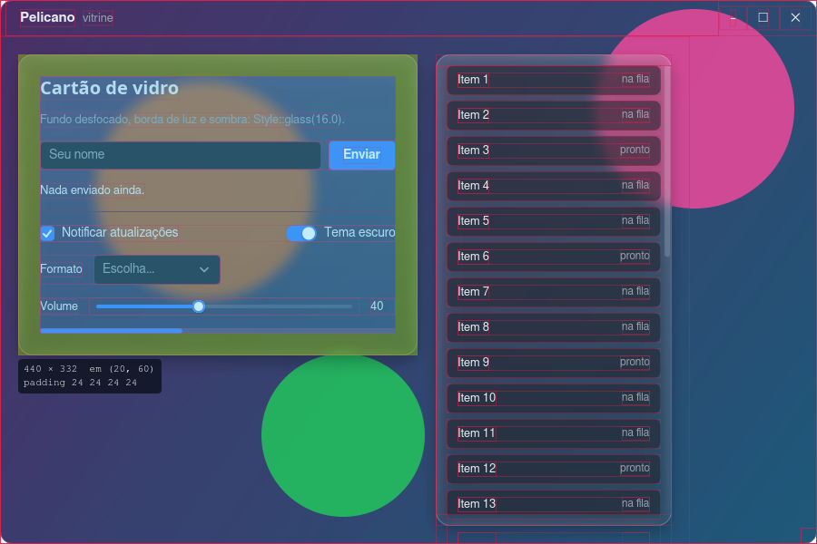
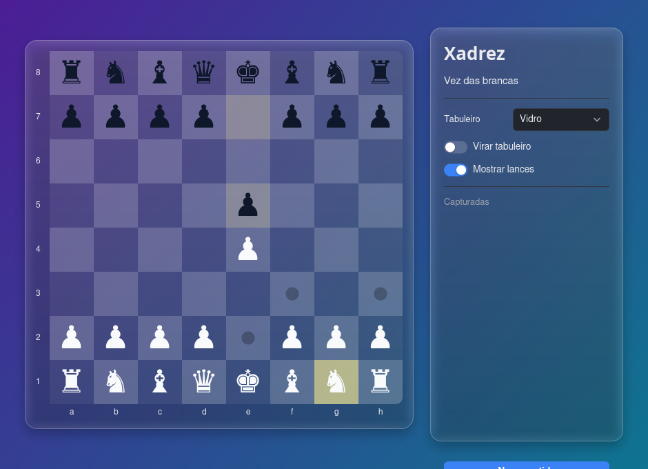
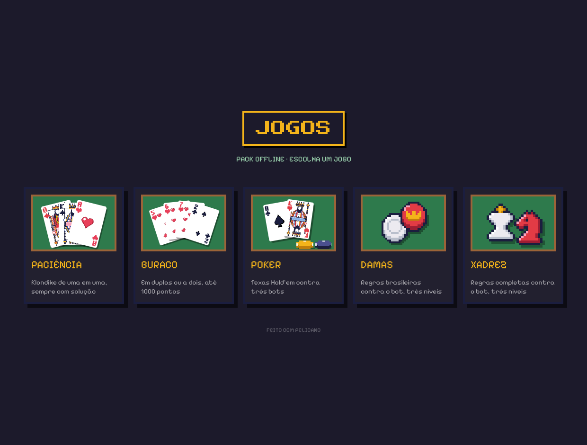
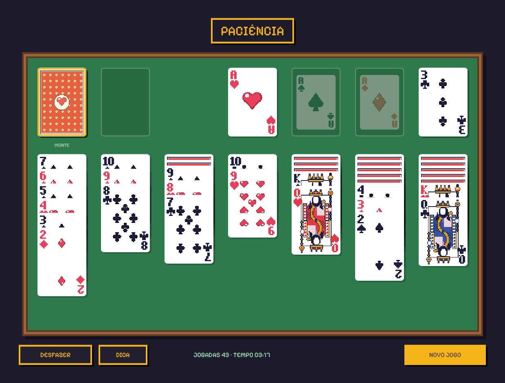
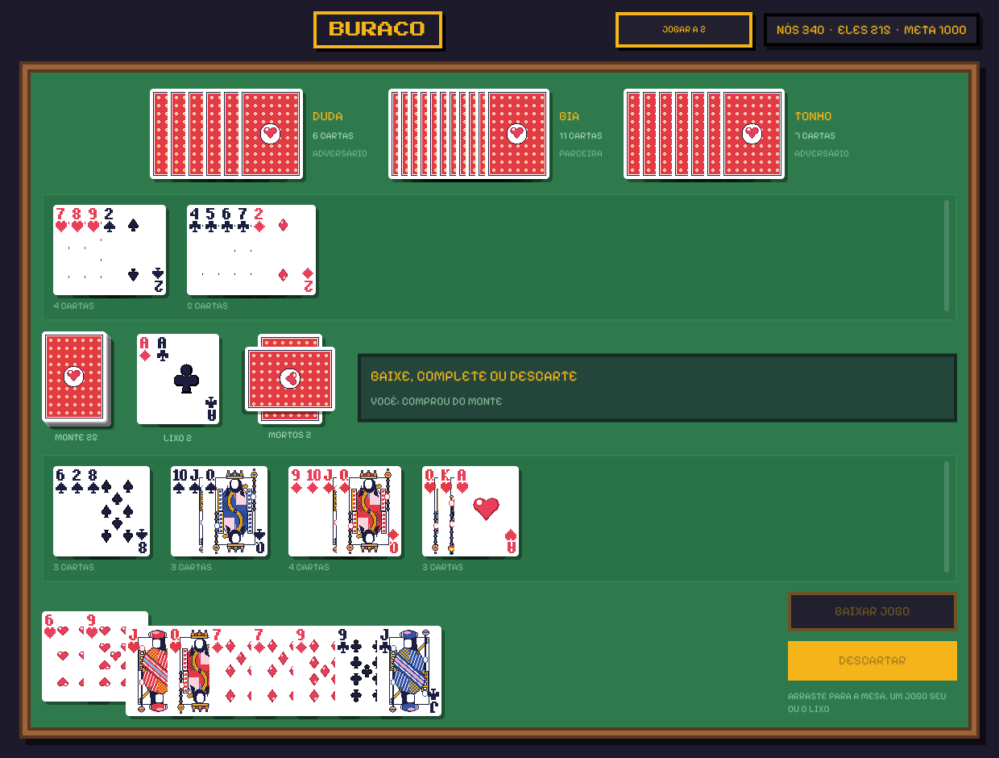

# Pelicano

Biblioteca de interface da suíte FeatherWorks, em Rust, **sem Iced**. O modelo é o
mesmo que a suíte já usa (estado, `update`, `view`), mas com tudo aberto para
personalizar — a ideia é chegar perto do que HTML + CSS permitem.



## O que ele faz que o Iced 0.13 travava

- **Janela sem moldura de verdade**: arrasta (`WindowCmd::Drag`) e redimensiona pela borda (`WindowCmd::DragResize`).
- **Janela translúcida** com cantos arredondados, e desfoque do desktop atrás (`Settings { transparent, blur }`; KDE/Windows/macOS — o GNOME ignora o desfoque).
- **Vidro em qualquer caixa**: `Style::backdrop_blur` (o `backdrop-filter` do CSS) e o preset `Style::glass(raio)`.
- **Recorte pelo raio**: `container(...).clip(true)` corta imagem, lista e qualquer filho nos cantos arredondados.
- Raio por canto, borda, sombra desfocada e gradiente em todo contêiner; **padding e margin**.
- **Transições e animações** como no CSS: `Style::transition`; `animate(..)` com opacidade, deslocamento, escala e rotação, `:hover`/`:active`, entrada, saída e laço; os widgets prontos já animam. O loop só desenha quadros enquanto algo anda (`cargo run --release --example animacoes`).
- **Acessibilidade** com AccessKit: botões, campos, caixas e textos chegam aos leitores de tela; `access_label` para ícones.
- Hover que respeita camadas (o botão debaixo de um menu aberto não acende) e cursor do mouse que muda sozinho.
- **Inspetor de layout** como o do navegador — desligado por padrão: `Settings { debug: true }` libera o F12 (ou `PELICANO_DEBUG=1`). Margem em laranja, padding em verde, conteúdo em azul, com o tamanho.
- **Captura sem janela**: `capture(&app.view(), tamanho, escala, &tema, &mut Renderer::new(), None)` devolve o PNG — para testes e miniaturas.
- `Widget` é um trait pequeno e público, e todo estilo é uma closure `Fn(&Theme, Status) -> Style`; `canvas` para desenho livre.



## Widgets

`text`, `button`, `container`, `row!`/`column!` (com `.wrap()`), `stack!`, `Space`,
`mouse_area` (com duplo clique), `opaque`, `scrollable` (roda e polegar arrastável),
`text_input` (com modo senha), `checkbox`, `toggler`, `pick_list`, `slider`,
`progress_bar`, `tooltip`, `image` (Fill/Contain/Cover), `svg` (com cor), `horizontal_rule`/`vertical_rule`, `canvas`.

## Exemplo

```sh
cargo run --example vitrine --features terminal,highlighter   # tudo o que o pelicano faz, por seção (F12 = inspetor)
cargo run --example vitrine --features terminal,highlighter -- --capturar pasta/   # só gera os PNGs
cargo run --example explorer --features terminal   # gerenciador de arquivos com terminal e monitor do sistema
cargo run --example xadrez                       # xadrez com temas (Clássico, Verde, Vidro)
```



### Pack de jogos offline

Paciência, buraco, pôquer, damas e xadrez em pixel art, todos contra bots, num menu só
(fontes Press Start 2P e Pixelify Sans, OFL, em `examples/assets`):

```sh
cargo run --release --example jogos              # o menu com os cinco
cargo run --release --example paciencia          # ou cada um sozinho: buraco, poker, damas, xadrez_pixel
```







## Como funciona

winit abre a janela; o quadro é desenhado na CPU com tiny-skia (texto com
cosmic-text, SVG com resvg) e o wgpu só leva a imagem pronta para a tela com alfa
pré-multiplicado — é isso que dá a transparência no Wayland.

## Ainda falta

Seleção no `text_input`, navegação por Tab, assinaturas de tempo (`every`),
executor tokio (para `reqwest`) e grid.

Licença MIT.
