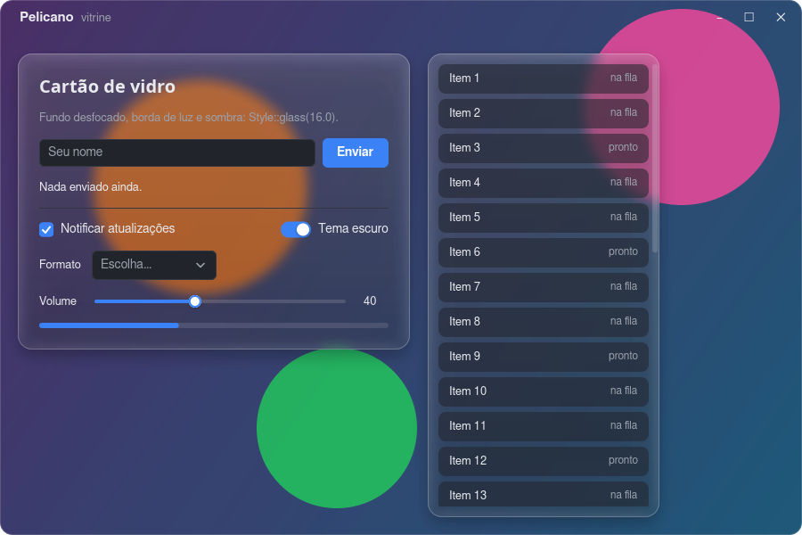
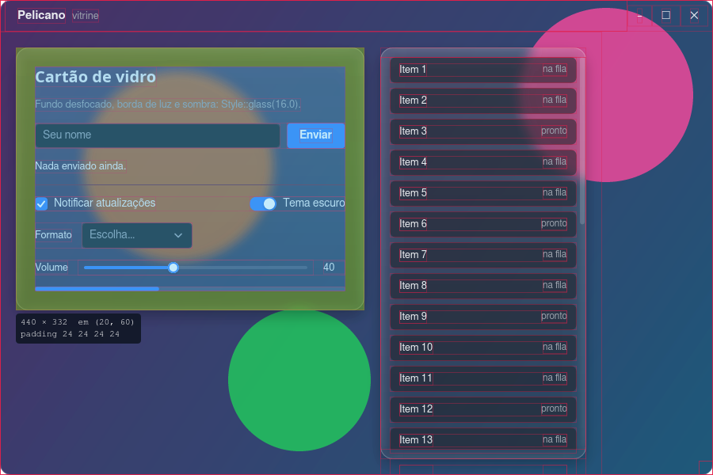
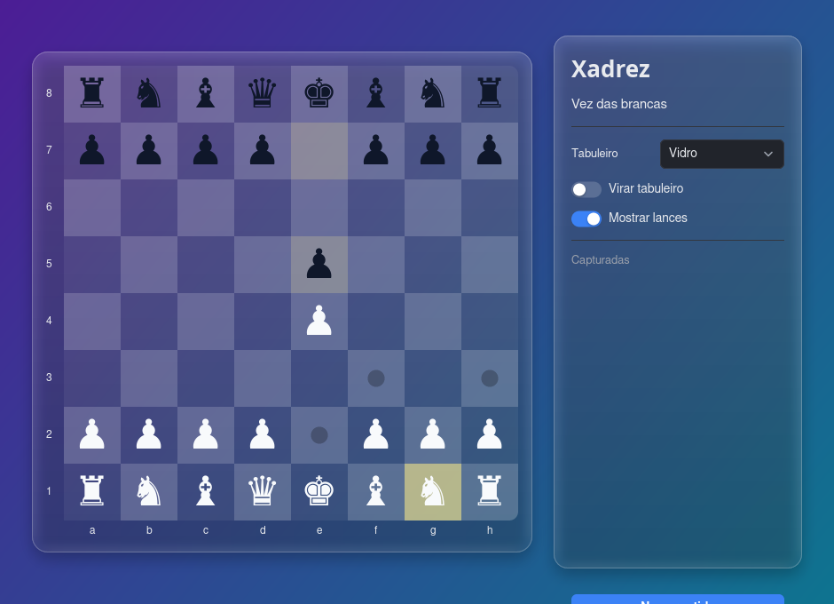
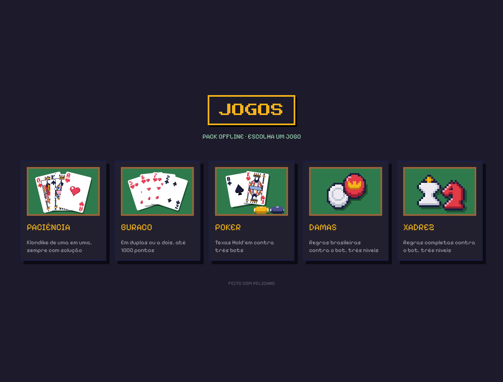
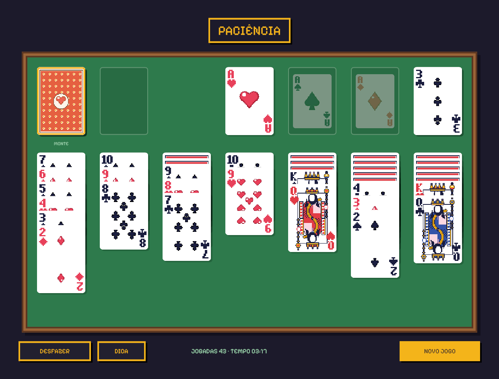
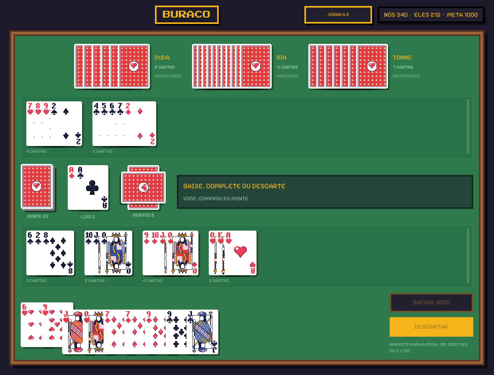

# Pelicano

GUI library of the FeatherWorks suite, in Rust. It uses the familiar Elm-style
model (state, `update`, `view`), with everything
open to customize — the goal is to get close to what HTML + CSS allow.

[Leia em português](README.pt-BR.md)



## Highlights

- **True frameless window**: drag it (`WindowCmd::Drag`) and resize it from the edge (`WindowCmd::DragResize`).
- **Translucent window** with rounded corners, and the desktop blurred behind it (`Settings { transparent, blur }`; KDE/Windows/macOS — GNOME ignores the blur).
- **Glass on any box**: `Style::backdrop_blur` (CSS `backdrop-filter`) and the `Style::glass(radius)` preset.
- **Clip to the radius**: `container(...).clip(true)` cuts images, lists and any child at the rounded corners.
- Per-corner radius, border, blurred shadow and gradient on every container; **padding and margin**.
- **Transitions and animations** like CSS: `Style::transition`; `animate(..)` with opacity, offset, scale and rotation, `:hover`/`:active`, enter, exit and loop; the built-in widgets already animate. The loop only draws frames while something moves (`cargo run --release --example animacoes`).
- **Accessibility** with AccessKit: buttons, fields, boxes and text reach screen readers; `access_label` for icons.
- Hover that respects layers (the button under an open menu does not light up) and a mouse cursor that changes by itself.
- **Layout inspector** like the browser's — off by default: `Settings { debug: true }` enables F12 (or `PELICANO_DEBUG=1`). Margin in orange, padding in green, content in blue, with the sizes.
- **Capture without a window**: `capture(&app.view(), size, scale, &theme, &mut Renderer::new(), None)` returns the PNG — for tests and thumbnails.
- **Recorded demos**: `PELICANO_ROTEIRO=demo.txt` makes the app follow a script with a drawn cursor ("Claude", orange): it moves to a widget by its text, clicks, types, presses keys and scrolls; `PELICANO_GRAVAR=demo.mp4` records the window with `ffmpeg` (on its own, it records you using the app). Script format in `src/roteiro.rs`. With the app running, `Task::window_of(id, WindowCmd::Roteiro(text))` does the same in any window (this is how an AI drives the app over MCP); `validar_roteiro` checks the text first.
- `Widget` is a small public trait, and every style is a closure `Fn(&Theme, Status) -> Style`; `canvas` for free drawing.



## Widgets

`text`, `button`, `container`, `row!`/`column!` (with `.wrap()`), `stack!`, `Space`,
`mouse_area` (with double click), `opaque`, `scrollable` (wheel and draggable thumb),
`text_input` (with password mode), `checkbox`, `toggler`, `pick_list`, `slider`,
`progress_bar`, `tooltip`, `image` (Fill/Contain/Cover), `svg` (with color), `horizontal_rule`/`vertical_rule`, `canvas`.

## Examples

```sh
cargo run --example vitrine --features terminal,highlighter   # everything pelicano does, by section (F12 = inspector)
cargo run --example vitrine --features terminal,highlighter -- --capturar folder/   # only writes the PNGs
cargo run --example explorer --features terminal   # file manager with a terminal and a system monitor
cargo run --example xadrez                       # chess with themes (Classic, Green, Glass)
```



### Offline game pack

Solitaire, buraco, poker, checkers and chess in pixel art, all against bots, in a single menu
(Press Start 2P and Pixelify Sans fonts, OFL, in `examples/assets`):

```sh
cargo run --release --example jogos              # the menu with all five
cargo run --release --example paciencia          # or each one alone: buraco, poker, damas, xadrez_pixel
```







## How it works

winit opens the window; the frame is drawn on the CPU with tiny-skia (text with
cosmic-text, SVG with resvg), and wgpu only carries the finished image to the screen
with premultiplied alpha — that is what gives transparency on Wayland.

## Still missing

Selection in `text_input`, Tab navigation, time subscriptions (`every`),
a tokio executor (for `reqwest`) and grid.

MIT license.
